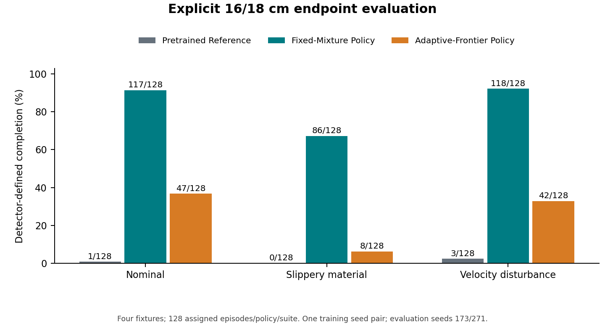
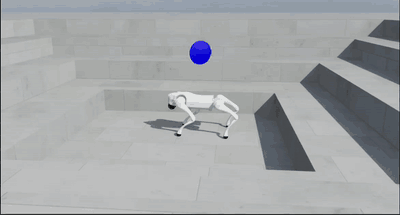
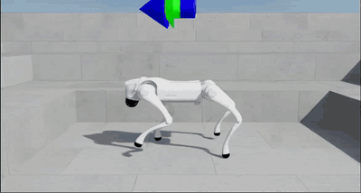

# Experience Allocation and Acquisition–Retention Trade-offs in Blind Quadruped Obstacle Learning

**Bhuvan Lakhera and Deepan Muthirayan**
Technical report · v1.1.0 · 2026

**Why does one blind locomotion policy acquire difficult obstacle skills while
another struggles under the same training budget?** We studied this by changing
how training experience was allocated across a shared set of locomotion tasks,
then measuring climbing and ordinary locomotion together.

## Principal result

*Original detector-defined completion comparison. The two continuation arms share a training budget; the historical pretrained reference is not an equal-budget control.*

| Historical nominal 16–18 cm evaluation | Detector-defined completions |
|---|---:|
| Fixed-Mixture Policy | **117/128 · 91.4%** |
| Adaptive-Frontier Policy | **47/128 · 36.7%** |
| Pretrained Reference | **1/128 · 0.8%** |

A policy trained using a fixed task mixture completed **31/32 isolated 18 cm steps** and **25/32 three-riser
18 cm staircases**. This is one matched training-seed pair, evaluated with two
seeds. The pretrained reference is historical, not an equal-budget control.

## What we compared

Both continuations started from the same prior, used the same task bank and reward,
and received **131,072,000 environment transitions**. One used a fixed
retention/ascent mixture; the other used a specified competence-frontier adaptive
sampler. The comparison tests that allocation choice in this setting, not a new
curriculum algorithm or a universal ranking of fixed and adaptive sampling.

The fixed run received approximately **13.1× as many assignments** and **17.1× as
much environment-time** on the two hardest explicit training tasks. This difference
accompanied better acquisition, but the experiment does not isolate exposure as
the cause. The report retains task-level cases where adaptive sampling did better.

## Acquisition came with retention costs

Climbing completions alone did not describe the policy. On nominal ordinary tasks,
all three policies reached the horizon in 416/416 episodes, yet their tracking and
motion costs differed:

| Ordinary-task episode means | Pretrained Reference | Fixed-Mixture Policy | Adaptive-Frontier Policy |
|---|---:|---:|---:|
| Forward-velocity absolute error (m/s) | 0.04445 | 0.04824 | 0.05257 |
| Mean squared raw action increment | 0.11027 | 0.13066 | 0.11859 |
| Mean squared applied torque (Nm²) | 21.61225 | 22.58649 | 19.05370 |

The Fixed-Mixture Policy's action-change proxy was about 18.5% above the reference, while
slippery-terrain retention also exposed costs. Squared torque and raw action
increments are simulation proxies, not measured energy or hardware wear.
The lesson is to examine acquisition and retention together; more difficult
exposure is useful only if the policy learns the task.

## Watch the behavior

| Blind high-obstacle locomotion policy · simulation | Historical-reference attempt |
|---|---|
|  |  |

Click a preview for the full recording. The configured 28 cm scenes are qualitative
illustrations, not extra benchmark episodes or matched video trials. The measured
comparison above remains the original 16–18 cm evaluation.
[Recording context](media/README.md).

## Read the report and verify the published analysis

- [Complete technical report](TECHNICAL_REPORT.md).
- [Reader's guide and CPU analysis checks](docs/READING_GUIDE.md).
- [Original per-task results and figures](#figures).
- [Policy identities](docs/POLICY_IDENTITY_MAPPING.md) and [related work](references.bib).

The included tools regenerate figures and check the published numerical assets.
They do not reproduce PPO training, run a policy or launch a simulator. The
[engineering showcase](https://github.com/Bhuvanlakhera23/go2-rl-locomotion)
describes the wider locomotion pipeline and physical robot work.

## Figures

| Question | Figure |
|---|---|
| Which obstacles were completed? | [High-obstacle completion](figures/01_high_completion.png) |
| Which tasks received training time? | [Training-task exposure](figures/02_training_exposure.png) |
| How did allocation change? | [Sampling probabilities](figures/03_allocation_probabilities.png) |
| What accumulated during training? | [Training outcomes](figures/04_training_outcomes.png) |
| What happened to ordinary locomotion? | [Acquisition–retention](figures/05_acquisition_retention.png) |
| Where did the aggregate ranking reverse? | [Per-fixture counterexamples](figures/06_fixture_counterexamples.png) |

## Scope and citation

Completion uses the original supported-traversal detector; independent contact
or visual ground truth was not established. One continuation-training seed cannot
estimate learning reliability across seeds. The study includes no completed
reward-OFF ablation or hardware-transfer evaluation. The full report explains
these limits and the original evaluation contract.

**Bhuvan Lakhera and Deepan Muthirayan (2026).** *Experience Allocation and
Acquisition–Retention Trade-offs in Blind Quadruped Obstacle Learning.*
Technical report v1.1.0; not a peer-reviewed conference publication.
[Original release](https://github.com/Bhuvanlakhera23/go2-obstacle-learning-rl/releases/tag/v1.1.0) ·
[CITATION.cff](CITATION.cff).

The original report, figures, tables and release remain unchanged. Manuscript,
figures and numerical tables retain **CC BY 4.0**; supporting plotting/verification
code retains **MIT**. [File-scoped licensing](LICENSE.md).
