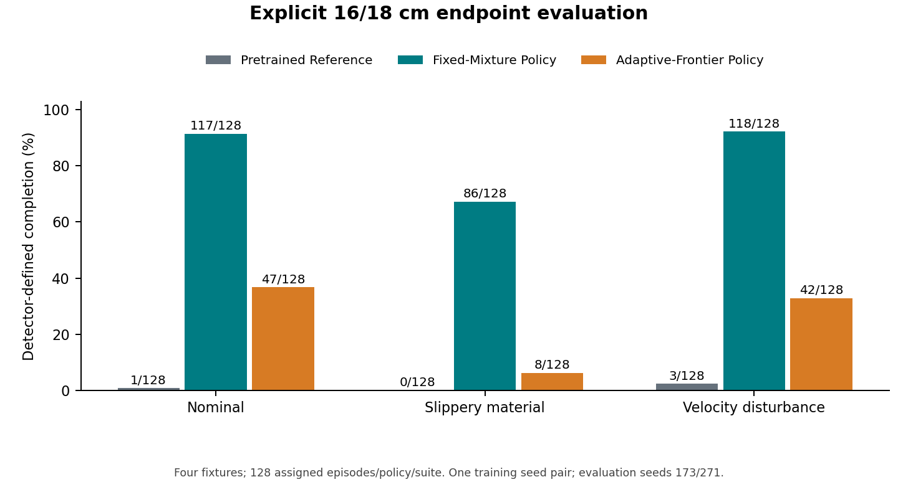
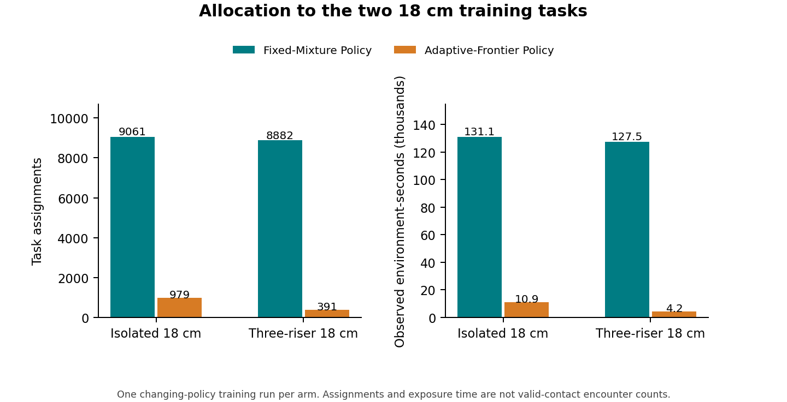
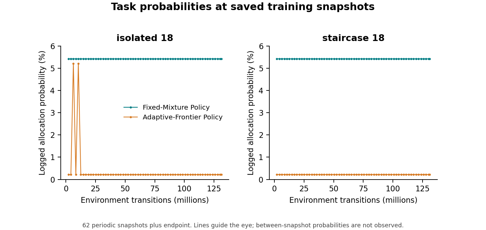
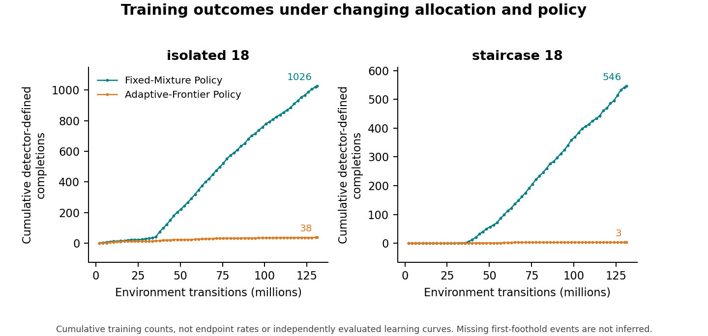
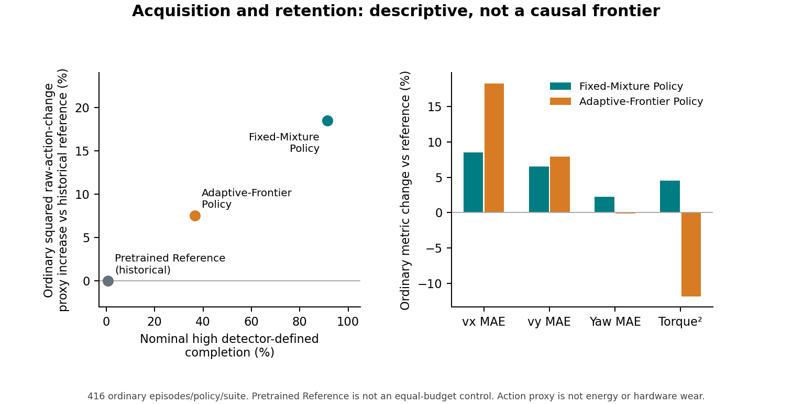
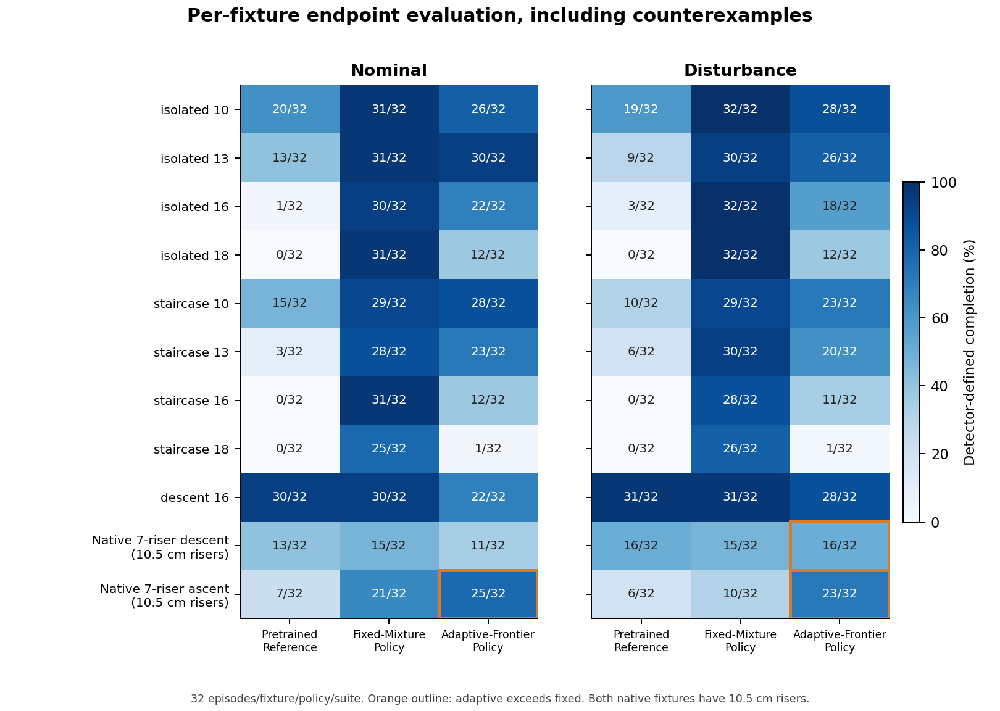

# Experience Allocation and Acquisition–Retention Trade-offs in Blind Quadruped Obstacle Learning

## A Single-Seed Quadruped Reinforcement Learning Simulation Study

Bhuvan Lakhera and Deepan Muthirayan

ARK Foundation Robotics Lab, Plaksha University, India.

Technical report V1.1 · RC2 · Public release authorized by the authors

© 2026 Bhuvan Lakhera and Deepan Muthirayan. [CC BY 4.0](LICENSE.md).

This report consolidates a completed development experiment. It is not a
peer-reviewed publication, a deployment qualification or a claim of independently
validated physical traversal. “Detector-defined completion” means the operational
outcome specified below, not independently measured contact ground truth.

## Abstract

We study how training-task allocation relates to the acquisition of high-obstacle
locomotion by a blind Unitree Go2 policy. Two policies were continued from the
same complete pretrained weights with fresh Adam optimizers, a common reward
and a budget of 131,072,000 environment transitions per arm. The intervention was
a fixed retention/ascent mixture versus one competence-frontier adaptive sampler.
The comparison comprises **one matched training-seed pair**. On four nominal
16–18 cm isolated and three-riser evaluation fixtures, fixed sampling produced
**117/128 detector-defined completions**, adaptive sampling **47/128**, and the
unmodified Pretrained Reference **1/128**. Across the two 18 cm training tasks, the
fixed run received approximately 13.1 times as many assignments and 17.1 times
as much environment-time exposure. These differences are consistent with an
allocation-related acquisition bottleneck, but do not identify exposure as a
causal mediator. The acquisition advantage coexisted with ordinary-motion costs:
the Fixed-Mixture Policy's nominal squared-action-change proxy was approximately 18.5%
above the reference, and its slippery-surface horizon completion was lower.
Adaptive sampling also performed better on a lower-height seven-riser ascent.
The findings therefore describe a task- and budget-dependent development result,
not general fixed-sampling superiority. Independent training-seed replication,
visual traversal adjudication and physical-contact validation are absent; the
shared milestone reward has not been isolated by a reward-OFF experiment.

## 1. Introduction

Climbing a step is not equivalent to tracking a velocity command near one. In
this study, successful obstacle negotiation requires the recorded progression
of the body and all feet, subsequent detector-reported upper-surface support,
hind-foot clearance and destination motion. A policy can receive local shaping
or remain upright without satisfying that sequence. Consequently, obstacle
acquisition depends not only on the policy and reward, but also on which task
encounters occur during a finite training run.

Foundation-02B provides a controlled development comparison of two allocations
over a common task universe. A fixed mixture maintains a persistent share of
practice on every ascent task. A competence-frontier sampler concentrates its
mass on selected unmastered tasks and their neighbors while retaining a small
exploration floor. The question is whether these two allocations produce
different acquisition and retention outcomes within the same interaction budget.
We do not introduce either fixed sampling or curriculum learning as a new
algorithm. Our purpose is to make the observed comparison inspectable, including
the cases in which its headline result does not generalize.

Three boundaries are important. First, both trained arms use the same
contact-milestone shaping; their comparison cannot establish that shaping is
necessary. Second, Pretrained Reference is the prior from which both arms start, not an
equal-budget control. Third, the shaping and evaluation share a detector.
Reproducing its terminal labels checks internal consistency but does not establish
the physical validity of its contact interpretation. We report a completed,
single-seed development case with these limitations intact.

Massively parallel legged RL and terrain curricula provide the broader setting
for this question [R1]. Environment generation, learning-progress allocation and
predictive safety allocation pursue different curriculum objectives [R2], [R3],
[R4]. Our narrow comparison is neither an implementation nor a refutation of
those methods.

### Related work and scientific positioning

Rudin et al. connect parallel quadruped learning with a game-inspired terrain
curriculum [R1]. Eurekaverse generates progressively challenging environment code
using language models [R2]. These address scalable training and environment
construction; Foundation-02B instead holds a finite task bank fixed.

LP-ACRL reallocates experience using changes in episodic return across a
multidimensional task space [R3]. Its learning-progress signal is not the
competence/mastery frontier used here. PSC prioritizes terrain contexts and
randomized events using predicted safety cost, without changing the task reward
or policy-optimization loss [R4]. PSC is a preprint, not a claimed accepted paper.

| Work | Task domain | Allocation signal | Contribution | Not inferable for Foundation-02B |
|---|---|---|---|---|
| Rudin et al. [R1] | ANYmal terrain locomotion | Game-inspired terrain progression | Massively parallel learning with terrain curriculum | Its outcomes do not rank our two samplers |
| Eurekaverse [R2] | Quadruped parkour | LLM-generated environment progression | Automated environment-curriculum construction | Generated environments are not our fixed 23-task bank |
| LP-ACRL [R3] | Multidimensional rough-terrain locomotion | Estimated episodic-return progress | Progress-based task sampling | Our competence-frontier result is not an LP-ACRL test |
| PSC [R4] | Reliability-oriented legged locomotion | Predicted future safety cost | Safety-directed experience allocation | Our completion comparison does not evaluate its safety objective |
| Foundation-02B | Blind Go2 obstacle/retention fixtures | Fixed mixture versus specified competence frontier | Controlled single-seed development comparison | No new curriculum algorithm or global sampler ranking |

The empirical contribution is a detector-defined acquisition difference under a
shared prior, reward and interaction budget, accompanied by different hard-task
exposure and retention costs. Algorithms, policies, task distributions and
evaluation criteria differ across the cited studies. No cross-paper performance
ranking, causal mediation result or general argument against adaptive curricula
follows. Bibliographic status and primary-source checks are documented in
[related-work verification](docs/RELATED_WORK_VERIFICATION.md).

## 2. System and methods

### 2.1 Simulation, policy and actions

The system is a simulated Unitree Go2 trained in the Isaac Lab/PhysX stack.
The actor is blind to exteroceptive terrain input. Its current proprioceptive
frame contains angular velocity, projected gravity, command, joint-position
residuals, joint velocities and previous actions. A temporal encoder processes
the saved history representation; a privileged critic receives additional
training information. The original history packing and direct reshape semantics
are retained. We do not claim that its pseudo-time organization has been
independently validated as a chronological frame stream.

| Component | Common configuration in both arms |
|---|---|
| Current actor observation | 45 values |
| Saved history representation | 100 frames, 4,500 flattened values; legacy term-major packing retained |
| Temporal feature | 64 values; actor input 109 values |
| Actor | MLP widths 512/256/128, ELU |
| Privileged critic additions | Groups of 3/27/187 values; same actor/critic tensor schema in both arms |
| Action | 12 residual joint-position commands, scale 0.25, original joint order/default pose |
| Nominal actuator settings | Kp 25, Kd 0.5; torque/saturation 23.5 Nm; velocity limit 30 rad/s |
| Physics and control | Physics period 0.005 s, decimation 4, control period 0.02 s |
| Observation normalization | Actor and critic normalization disabled |

Source: saved configurations and the verified [experiment comparison][S2].
These describe the retained implementation, not a reconstructed complete
historical machine image. Runtime provenance limitations appear in Section 7.

### 2.2 Matched continuation training

Both arms load all 27 model tensors from Pretrained Reference, including temporal, actor,
critic and noise parameters. The prepared initializer contains empty Adam state.
The experiment is full-weight continuation with a fresh optimizer, not training
from scratch or an actor-only copy. Each trained endpoint changes 23 model tensors
relative to initialization while retaining the original tensor schema. [S1], [S2]

| Variable | Fixed-Mixture Policy | Adaptive-Frontier Policy |
|---|---|---|
| Training seed | 73 | 73 |
| Initial weights and optimizer | Same complete weights; fresh Adam | Same complete weights; fresh Adam |
| Environment task universe | Same 23 descriptors | Same 23 descriptors |
| Reward, commands, resets and terminations | Shared | Shared |
| PPO budget | 1,000 updates × 4,096 environments × 32 steps | Same |
| Total environment transitions | 131,072,000 | 131,072,000 |
| Initial learning rate | 0.0001, adaptive schedule | Same |
| PPO settings | Five epochs; four minibatches; clip 0.2; gamma 0.99; lambda 0.95 | Same |
| Other optimizer settings | Entropy 0.002; desired KL 0.01; max gradient norm 1.0 | Same |
| Endpoint selection | Last update, index 999 | Last update, index 999 |
| Intended intervention | Fixed allocation | Competence-frontier allocation |

The saved agent configurations are byte-identical. The saved environment
configurations differ only in the sampler flag and output directory. Equal
interaction budgets do not imply equal wall time, identical physical initial
states or identical subsequent optimization trajectories. Data-dependent
learning-rate updates and policy-dependent outcomes can diverge after allocation
changes. This is one matched configuration/seed comparison, not a randomized
multi-seed experiment.

Pretrained Reference is evaluated without the additional Foundation-02B training. Compared
with the reference's historical training, Foundation-02B also changes task and
encounter construction, optimizer state, reward design and optimization budget.
Its reference contrast is therefore explicitly non-causal.

### 2.3 Task universe and encounter construction

The training universe comprises 23 tasks: seven ordinary commands on flat
terrain; five isolated ascents and five three-riser ascents at 6/9/12/15/18 cm;
three explicit descents at 12/15/18 cm; one seven-riser native descent at 12 cm;
and two native ascents at 9/12 cm. The ordinary commands are forward, backward,
left, right, positive yaw, negative yaw and stand. Full descriptors are provided
in [the training-task table][Ttrain].

Obstacle encounters use task-aligned source-side resets and prescribed commands,
not unconstrained exploration from arbitrary approaches. The 11 retention tasks
are the ordinary tasks and descents; the 12 remaining tasks are ascents. This
retention grouping is an allocation category, not proof that every skill is
retained after training.

### 2.4 Sampling intervention

Let R be uniform mass over the 11 retention tasks and A uniform mass over the
12 ascent tasks. The fixed distribution is

`p_fixed = 0.35 R + 0.65 A`.

Thus fixed sampling is not uniform over all tasks. Each ascent receives
probability 0.65/12 ≈ 0.0541667; each retention task receives 0.35/11.

The tested adaptive distribution is

`p_adaptive = 0.35 R_adaptive + 0.45 F + 0.15 E + 0.05 U`,

where U is uniform over all 23 tasks. F places equal mass on the selected
frontier task in each of the isolated, staircase and native-ascent families;
E selects the adjacent task, capped at the last family member. The frontier is
the first currently unmastered task, or the last task if all are mastered.
When a mastered obstacle exists, `R_adaptive = 0.7 R + 0.3 M`, with M uniform
over mastered obstacles; otherwise `R_adaptive = R`.

Mastery uses a 64-outcome history, at least 32 valid observations and 16 attempted
encounters. With Wilson parameter z=1.645, a lower bound of at least 0.6 marks
mastery and an upper bound below 0.4 removes it. The exploration component gives
every task nonzero probability. This is a particular discrete competence-frontier
controller, not a claim about all adaptive curricula. [S1]; exact sampler source
is identified in Appendix A1 of [the reproducibility appendix](docs/REPRODUCIBILITY.md).

### 2.5 Shared reward

Both arms retain the same locomotion shaping and a milestone term of weight 1.0.
Within an attempt, a total credit bounded by 1.0 is divided into up to 0.25 for
foot/riser milestones, 0.25 for hind-transfer completion and 0.50 for the final
destination condition. Event increments are converted to a reward rate before
the environment's timestep scaling. Milestone flags prevent repeated credit for
the same event. The detector and its termination decisions remain part of both
arms. [S1]; source functions are identified in Appendix A1.

Crucially, a later reported upper-surface support can certify an earlier crossed
plane in the detector. Neither a milestone count nor full payout means that a
foot physically contacted every intermediate tread. No reward-OFF result is
available, so we make no reward-necessity claim.

## 3. Evaluation protocol

### 3.1 Fixtures, suites and denominators

Each policy is evaluated in three suites: nominal; slippery robot material
(static and dynamic friction set to 0.2); and the saved velocity-disturbance
event configuration. The disturbance is a particular inherited push intervention,
not a general disturbance distribution. Exact source/settings and saved
configurations are identified in the reproducibility appendix.

The evaluation bank contains 24 tasks: eight explicit ascent fixtures
(isolated/three-riser × 10/13/16/18 cm); one explicit descent at 16 cm; native
ascent and descent at 10.5 cm with seven risers; seven ordinary commands; and
forward/backward rough and ascending/descending-slope tasks. Two evaluation
seeds, 173 and 271, each provide 16 assigned environments per task. Consequently,
each policy/suite has 768 first episodes, each fixture 32, and the four-fixture
16–18 cm cohort 128. The complete original comparison contains 6,912 unique
first-episode records across three policies, three suites and two seeds. [Ttask], [Tseed]

Task assignment is `env_id modulo 24` in a 384-environment invocation. The
evaluator retains only the first terminal episode of each assigned environment;
later resets do not supply replacement outcomes. Its horizon is 1,000 controls.
Original terminal records contain no active, invalid, unknown or censored cases.
Their absence is checked in the records, not imposed by dropping those categories.

The explicit evaluation geometry changes tread from 0.35 to 0.40 m, approach
from 0.8 to 1.0 m, landing from 1.8 to 2.0 m and yaw from zero to 0.12 rad.
Sixteen-centimeter height is absent from the training ladder; eighteen-centimeter
height is trained. These are held-out combinations, not entirely unseen high
heights or a test of arbitrary staircases. Native evaluation is at 10.5 cm,
not seven successive 18 cm risers. Full descriptors are in [Ttask].

### 3.2 Operational definition of detector-defined completion

The following summarizes the actual retained batched detector, rather than
inferring completion from reward totals. Coordinates are transformed into the
assigned route frame. Reported contact positions and world-z forces come from
the existing terrain-filtered per-foot sensor path. They are not independent
PhysX contact measurements.

| Detector stage | Operational requirement in the retained implementation |
|---|---|
| Valid source support | Before the first riser, at least two reported source-level feet and eligible vertical load sum at least 0.35 times body weight |
| Attempt | Source latch, at least 0.10 m progress, and engagement: near the first riser with forward speed above 0.03 m/s, or reported upper-level support |
| Foot/riser credit | A previously sampled plane crossing followed by eligible reported support above that riser; credit is latched per foot/plane |
| Hind transfer | Hind credit complete and both hind feet at least 0.03 m beyond the final plane |
| Destination geometry | Body/foot crossings recorded; body in destination interval; all feet beyond the final plane and within the destination extent |
| Motion/stability | Forward command and route velocity at least 0.08 m/s, tilt at most 0.35 rad, roll/pitch-rate norm at most 1 rad/s |
| Destination interval | At least 0.30 s qualifying dwell; supported fraction at least 0.60; unsupported gap above 0.10 s resets dwell/support accumulators |
| Support history | At least one forefoot and one hind foot have eligible final-level support during the qualifying interval; all required paid flags complete; no latched unknown evidence |

Individual eligible feet require reported world-z force of at least 10 N, a
finite contact point no more than 0.08 m from the foot, surface-height agreement
within 0.015 m and a 0.02 m interior-edge margin. These source thresholds are
operational choices, not calibrated physical measurement accuracy. Invalid
spawn, nonfinite data, teleport/sample-gap checks and fall/collision/corridor/
wrong-way/stuck outcomes guard the sequence. Ordinary horizon outcomes use a
separate retention category, not obstacle completion. [S1]; exact source in Appendix A1.

A successful terminal record must consistently report attempted encounter,
hind completion, dwell of at least 0.30 s and full payout. The offline validator
checks these fields and episode identity. It cannot independently reobserve the
underlying support, certify continuous physical stability or extend persistence
beyond the original successful termination.

### 3.3 Statistical interpretation

All results are descriptive. The independent learning-replication count is one
per sampler. Evaluation seeds, vectorized episodes and checkpoints do not
increase it. We provide exact numerators and denominators, not episode-derived
confidence bars or significance claims about training reliability. The shared
policy, geometry and simulator create correlations. Equal env IDs do not prove
paired physical randomizations across policy invocations.

## 4. Results

### 4.1 High-obstacle endpoint evaluation

On the nominal high cohort, fixed sampling yields 117/128 detector-defined
completions (91.40625%), adaptive 47/128 (36.71875%) and Pretrained Reference 1/128
(0.78125%): a descriptive fixed–adaptive difference of 54.6875 percentage points.
The respective counts at evaluation seeds 173/271 are fixed 59/64 and 58/64,
adaptive 25/64 and 22/64, and reference 1/64 and 0/64. Similar evaluation-seed
results do not replicate the learning process. [Tseed], [Tcohort]

| Nominal explicit fixture | Pretrained Reference | Fixed-Mixture Policy | Adaptive-Frontier Policy |
|---|---:|---:|---:|
| Isolated 10 cm | 20/32 | 31/32 | 26/32 |
| Isolated 13 cm | 13/32 | 31/32 | 30/32 |
| Isolated 16 cm | 1/32 | 30/32 | 22/32 |
| Isolated 18 cm | 0/32 | 31/32 | 12/32 |
| Three-riser 10 cm | 15/32 | 29/32 | 28/32 |
| Three-riser 13 cm | 3/32 | 28/32 | 23/32 |
| Three-riser 16 cm | 0/32 | 31/32 | 12/32 |
| Three-riser 18 cm | 0/32 | 25/32 | 1/32 |

Table 1. Detector-defined completions over assigned first episodes. All lower
heights are shown rather than selecting only the largest gap. Source: [Tfixture].

Figure 1. Endpoint detector-defined completion on the four explicit 16/18 cm
fixtures, by suite. Counts use 128 assigned first episodes per policy/suite.
No training-seed uncertainty is available. Source: [Tcohort].

### 4.2 Adverse-suite results and detector failure reasons

| High-16/18 suite | Pretrained Reference | Fixed-Mixture Policy | Adaptive-Frontier Policy |
|---|---:|---:|---:|
| Nominal | 1/128 | 117/128 | 47/128 |
| Slippery material | 0/128 | 86/128 | 8/128 |
| Velocity disturbance | 3/128 | 118/128 | 42/128 |

Fixed retains a large high-cohort advantage in these two additional suite
definitions, but its slippery result is lower than nominal. The comparison does
not test arbitrary friction profiles, unmodeled impacts or real-world robustness.

| Nominal high outcome/reason | Pretrained Reference | Fixed-Mixture Policy | Adaptive-Frontier Policy |
|---|---:|---:|---:|
| Detector-defined completion | 1 | 117 | 47 |
| Stuck failure | 71 | 2 | 51 |
| Corridor/tile failure | 45 | 3 | 5 |
| Collision failure | 10 | 3 | 2 |
| Fall failure | 1 | 1 | 13 |
| Timeout | 0 | 2 | 10 |
| Total assigned | 128 | 128 | 128 |

Table 2. Terminal accounting, not an independently localized biomechanical failure
diagnosis. All suite-specific reason distributions are supplied in [Tfailure].

### 4.3 Training exposure and recorded learning histories

The fixed run records 165,329 total assignments and the adaptive run 163,650.
Across isolated-18 and staircase-18, fixed records 17,943 assignments against
1,370 and 258,571.64 environment-seconds against 15,159.78: approximately 13.1×
the assignments and 17.1× the exposure time. Both arms sum to 2,621,440
environment-seconds at the same transition budget. Episode duration and outcomes
affect exposure time in addition to the sampler's requested allocation. [Texposure]

| Training task | Fixed-Mixture assignments | Adaptive-Frontier assignments | Fixed-Mixture closed detector-defined completions | Adaptive-Frontier closed detector-defined completions |
|---|---:|---:|---:|---:|
| Isolated 18 cm | 9,061 | 979 | 1,026 | 38 |
| Three-riser 18 cm | 8,882 | 391 | 546 | 3 |

These cumulative training counts arise under evolving stochastic policies and
changing task mixtures. They are not endpoint evaluation rates or counts of
independent contact encounters. No 16 cm training task exists. [Texposure]

Figure 2. Assignments and observed environment-time for the two 18 cm training
tasks. An assignment does not certify a valid encounter. Source: [Texposure].

In every saved snapshot, adaptive staircase-18 has probability 0.05/23,
approximately 0.00217391, whereas fixed assigns approximately 0.0541667.
Adaptive isolated-18 occasionally reaches approximately 0.0521739 but ends at
the exploration floor. Nonzero access is therefore present: the evidence is
underallocation in the retained windows, not a disconnected sampling path.

Figure 3. Logged task probabilities at 62 periodic snapshots and the endpoint.
Adjacent periodic samples are separated by 512 controls, or 2,097,152 environment
transitions. Lines guide the eye; no values between snapshots are recovered.
Source: [Thistory].

Figure 4. Cumulative closed detector-defined completions against training
transitions. These are training outcome histories, **not independently evaluated
policy learning curves**. Source: [Thistory].

The first saved staircase-18 completion appears by control 7,680 in fixed and
9,728 in adaptive; isolated-18 appears by 1,024 in both. These are upper bounds
at snapshot resolution, not exact acquisition times. TensorBoard contains 1,000
milestone-reward scalars per arm, with first positive logged updates 3/4 and
final values approximately 0.020689/0.019701 for fixed/adaptive. Aggregate reward
activation does not reveal first-foot contact, stage-specific credit frequencies
or the causal gradient mechanism. The historical logs do not support a joined
assignment → encounter → foothold → transfer → completion funnel. [S1], [Thistory]

### 4.4 Ordinary locomotion retention and motion-cost proxies

| Nominal ordinary metric | Pretrained Reference | Fixed-Mixture Policy | Adaptive-Frontier Policy |
|---|---:|---:|---:|
| Horizon outcomes | 416/416 | 416/416 | 416/416 |
| vx mean absolute error (m/s) | 0.04445 | 0.04824 | 0.05257 |
| vy mean absolute error (m/s) | 0.03662 | 0.03902 | 0.03951 |
| Yaw-rate mean absolute error (rad/s) | 0.08511 | 0.08706 | 0.08503 |
| Mean squared applied torque (Nm²) | 21.61225 | 22.58649 | 19.05370 |
| Mean squared raw action increment (raw action units²) | 0.11027 | 0.13066 | 0.11859 |

Table 3. Equal episode means over 13 ordinary fixtures and both evaluation seeds.
Each episode first averages over its own observed duration. Unequal episode
lengths mean these are not full-run time-weighted averages. Axis errors are kept
separate because linear and angular errors have different units. [Tcohort]

Figure 5. Nominal high-cohort acquisition versus ordinary action-change cost
(left) and reference-relative ordinary axis/torque changes (right). This is a
descriptive cross-policy comparison, not a causal contrast against Pretrained Reference.
The y-axis is a squared raw-action-change proxy, not energy or hardware wear;
the historical reference is not an equal-budget sampler control. No causal
Pareto frontier is inferred. Source: [Tcohort].

Fixed's nominal ordinary action-change proxy is approximately 18.5% above the
reference. Individual fixed/reference differences are approximately 29.1% for
forward flat and 59.3% for forward ascending slope. These are recorded costs,
not retroactively imposed acceptance thresholds. Adaptive has lower squared
torque than fixed, but lower torque during failed or stalled traversal would
not by itself indicate improved locomotion. Squared torque is not mechanical
energy; raw action increments are not joint acceleration or power.

| Ordinary horizon outcomes | Pretrained Reference | Fixed-Mixture Policy | Adaptive-Frontier Policy |
|---|---:|---:|---:|
| Nominal | 416/416 | 416/416 | 416/416 |
| Slippery material | 393/416 | 381/416 | 384/416 |
| Velocity disturbance | 416/416 | 416/416 | 416/416 |

The equal nominal horizon counts conceal tracking and smoothness costs. Under
slippery material, the Fixed-Mixture Policy's ordinary survival is also lower than the
reference. All signed-command axis errors, motion-cost proxies, horizons and
failure outcomes by fixture and suite are supplied in [Tfixture], including stand
and positive/negative directions; obstacle completion is not assigned to ordinary
tasks simply because they survive.

### 4.5 Counterexamples to a blanket sampler ranking

| Fixture/cohort | Nominal reference/fixed/adaptive | Disturbance reference/fixed/adaptive |
|---|---|---|
| Pooled explicit/native descents | 43/64 · 45/64 · 33/64 | 47/64 · 46/64 · 44/64 |
| Seven-riser native descent, 10.5 cm | 13/32 · 15/32 · 11/32 | 16/32 · 15/32 · 16/32 |
| Seven-riser native ascent, 10.5 cm | 7/32 · 21/32 · 25/32 | 6/32 · 10/32 · 23/32 |

Adaptive exceeds fixed on the lower-height native ascent in nominal and
disturbance evaluation, and on the native descent under disturbance. Fixed does
not exceed the reference on every descent cohort. These results are part of the
same original evaluation, not later negative experiments. [Tfixture], [Tcohort]

Figure 6. Every obstacle fixture in nominal and disturbance evaluation. Each cell
is a detector-defined completion count over 32 assigned first episodes. Orange
outlines identify adaptive-over-fixed cells. Native ascent/descent use 10.5 cm
risers. The full table also includes slippery results and ordinary fixtures.
Source: [Tfixture].

## 5. Discussion

The Fixed-Mixture Policy's high-cohort advantage and the corresponding hard-task
exposure disparity are consistent with a finite-budget allocation bottleneck.
The tested frontier controller devotes substantially less observed practice to
the two hardest explicit training tasks, even though it never excludes them.
An exploration floor can provide eventual access without supplying enough
practice within a particular budget. The cumulative outcome history makes that
interpretation concrete, but does not establish an exposure dose–response law.

Several alternative explanations remain compatible with the data. The single
optimization trajectory may amplify early differences. Transfer between task
families, encounter ordering, policy-dependent episode duration and adaptive
learning-rate behavior can interact with allocation. No exposure-matched
counterfactual separates these mechanisms. A per-attempt first-foot/hind-transfer
record cannot be reconstructed from aggregate milestones. Accordingly, we do
not identify a specific contact transition as the mediator of the outcome gap.

Retention changes also constrain the interpretation. The Fixed-Mixture Policy is not
simply a better copy of the reference: it combines substantially higher explicit
high-obstacle detector-defined completion with worse ordinary smoothness and
some adverse-suite costs. The native-ascent counterexample shows that a family-
specific frontier can remain advantageous elsewhere in the same finite bank.
These observations support reporting acquisition and retention together rather
than treating a high-obstacle percentage as a universal locomotion score.

The reference comparison demonstrates a change in capability after continuation
under the Foundation-02B recipe. It does not attribute that change to the
milestone reward, fixed sampling alone or a new architecture. The adaptive/fixed
comparison is more tightly controlled, but still establishes an observed outcome
for one development seed, not a reproducible population ranking.

The distinction between allocation signals matters: return progress [R3] and
predicted safety cost [R4] are not interchangeable with mastery-frontier status.
Likewise, generating environments [R2] differs from redistributing a fixed bank.
These related approaches motivate careful allocation diagnostics, not a claim
that our result disproves LP-ACRL, PSC or adaptive curricula generally. Nor does
it establish that fixed sampling is globally optimal. The bounded comparison
complements the parallel-training setting of [R1] without claiming its hardware
results or any new algorithmic priority.

## 6. Validation history and evidence scope

Subsequent engineering preparation did not provide independent contact ground
truth. The original native-contact attempt failed at CUDA startup; R2 failed at
a diagnostic inference-tensor pose write; R3 progressed further but failed in
periodic evaluation telemetry. Its raw-contact file was empty and callback
liveness could not be established from retained evidence. An isolated
single-body GPU physics probe did succeed, but does not validate the robot
contact collector or the completion detector.

The evaluation-snapshot repair remained unqualified after a stopped CPU
regression. A separate passive visual-export attempt then found an unresolved
per-view isolation contract: same-task replicas share task origins, and separate
cameras were not established as visually isolated selected-environment streams.
That source-layout finding is not proof that the original physics results are
wrong. It means that the proposed independent visual adjudication was not
completed. Both investigations are closed under their failed/unqualified
dispositions; no missing contact or image evidence is promoted to validation.
The frozen reward ablation remains unexecuted and unauthorized. [S5], [S6]

Later retention continuations and interpolation/anchoring studies use different
interventions and sometimes different evaluators. They are not pooled into this
report's counts or treated as additional Foundation-02B training seeds. Their
historical failed dispositions remain unchanged. This report's results and
figures contain the original B study only.

## 7. Limitations

| Limitation | Consequence for interpretation |
|---|---|
| One matched training-seed pair | No learning-reliability estimate or broad statistical superiority claim; evaluation episodes are not training seeds |
| Development-stage cohort selection and reused fixtures | Held-out combinations are not a pristine prospective confirmation set; repeated inspection may bias the narrative |
| Shared shaping/evaluation detector | Terminal consistency cannot independently establish physical support or actual tread contacts |
| No qualified independent visual adjudication | Visible whole-robot traversal has not been checked by the proposed blinded reviewer protocol |
| No milestone-reward OFF ablation | Reward necessity and reward–sampler interaction remain untested |
| Aggregate training histories | First-foot identity/time, valid-encounter conversion and exact failure stages are irrecoverable |
| Finite, task-aligned simulation scope | No arbitrary approaches, reverse obstacle traversal, 20 cm or hardware-transfer claim |
| Pretrained Reference historical training differs | Its contrast is non-causal; additional training and recipe changes are confounded |
| Incomplete historical launch provenance | Compatible source bytes and hashes are available, not a full launch environment or bitwise replay certificate |
| No completed novelty/peer-review assessment | No priority, acceptance, state-of-the-art or new-algorithm claim is made |

The absence of measured independent contact is a limitation, not evidence that
no contact occurred. Equally, strong detector-defined counts are not a substitute
for that missing measurement. No significance bars or imagined trajectories are
introduced to conceal these gaps.

## 8. Conclusion and future work

For one matched continuation-training seed and equal interaction budgets, the
fixed retention/ascent mixture substantially exceeded the specified frontier
sampler on detector-defined explicit 16–18 cm completion. Greater hard-task
allocation accompanied the difference, while ordinary-motion costs and a
native-ascent counterexample prevented a blanket superiority conclusion.

Independent training-seed replication and observable traversal validation remain
future work. A prospective replication proposal exists, but it has not been
executed and its observable-export prerequisite remains blocked. Any future
study would require separate scientific and execution approval; the present
report does not reopen the closed native-contact or export campaigns. The
appropriate current contribution is a transparent, reproducible development
case study with an explicit acquisition–retention boundary.

## Evidence and companion material

All displayed numerical results trace to original records or verified audit
outputs through [numerical provenance](docs/NUMERICAL_PROVENANCE.md). The
[reproducibility appendix](docs/REPRODUCIBILITY.md) specifies offline reconstruction,
source identities and units. The [claim–evidence–limitation matrix](docs/CLAIM_EVIDENCE_LIMITATIONS.md),
[missing-evidence checklist](docs/MISSING_EVIDENCE.md) and
[public-release checklist](docs/PUBLIC_RELEASE_CHECKLIST.md) bound public-release
claims. Related-work coverage is targeted to the four verified papers below,
not a comprehensive novelty search. The [editorial changelog](docs/EDITORIAL_CHANGELOG.md)
records changes from V1. Numerical data and plotting code are packaged for
offline review; original experiment source and checkpoints are not distributed
here. Public release of this report payload is authorized; report assets use
CC BY 4.0 and included code uses MIT. Excluded historical artifacts are not released.

Original policy identifiers and checkpoint hashes are retained in the
[identity mapping appendix](docs/POLICY_IDENTITY_MAPPING.md); checkpoint files are not renamed or included.

## References

- R1. Nikita Rudin, David Hoeller, Philipp Reist and Marco Hutter.
  *Learning to Walk in Minutes Using Massively Parallel Deep Reinforcement Learning.*
  PMLR 164:91–100, 2022 (5th CoRL, 2021). [Publisher record][R1].
- R2. William Liang, Sam Wang, Hung-Ju Wang, Osbert Bastani, Dinesh Jayaraman
  and Yecheng Jason Ma. *Environment Curriculum Generation via Large Language Models.*
  PMLR 270:433–454, 2025 (8th CoRL, 2024). [Publisher record][R2].
- R3. Ziming Li, Chenhao Li and Marco Hutter. *Scaling Rough Terrain Locomotion
  with Automatic Curriculum Reinforcement Learning.* IEEE Robotics and Automation
  Letters, 11(8):9295–9302, 2026. DOI:
  [10.1109/LRA.2026.3703486](https://doi.org/10.1109/LRA.2026.3703486).
  [Author-posted version][R3]; bibliographic metadata corroborated by the
  [authors' institutional publication listing](https://rsl.ethz.ch/publications-sources/publications.html).
- R4. Ivan Ovinnikov, Pascal Sutter, Christian Gehring and Jordis Herrmann.
  *Predictive Safety Curricula for Robust Legged Locomotion.* arXiv:2609.37070,
  submitted 29 September 2026. **Preprint.** [Version record][R4].

[S1]: docs/EVIDENCE_SOURCES.md#audit
[S2]: docs/EVIDENCE_SOURCES.md#comparison
[S3]: docs/EVIDENCE_SOURCES.md#publication-gate
[S4]: docs/EVIDENCE_SOURCES.md#prospective-gate
[S5]: docs/EVIDENCE_SOURCES.md#native-closure
[S6]: docs/EVIDENCE_SOURCES.md#export-closure
[Ttrain]: tables/training_tasks.csv
[Ttask]: tables/evaluation_tasks.csv
[Tseed]: tables/high_by_evaluation_seed.csv
[Tcohort]: tables/endpoint_cohorts.csv
[Tfixture]: tables/per_fixture.csv
[Tfailure]: tables/high_failure_reasons.csv
[Texposure]: tables/training_exposure.csv
[Thistory]: tables/training_snapshot_history.csv
[R1]: https://proceedings.mlr.press/v164/rudin22a.html
[R2]: https://proceedings.mlr.press/v270/liang25a.html
[R3]: https://arxiv.org/abs/2601.17428
[R4]: https://arxiv.org/abs/2609.37070
